# Contoh gagal

Frame yang pernah Irfan tolak. Tiap entri: gambar, apa yang salah, dan konteksnya. Ini **bukan** daftar larangan: yang ditolak adalah kasusnya, bukan jenis elemennya. Lihat sebelum menilai still sendiri.

Menambah entri: simpan frame sebagai `<no>-<nama-pendek>.jpg` (lebar ≤ 1400 px), tambah satu blok di bawah.

## 01 · Serif pucat raksasa + subtitle kotak
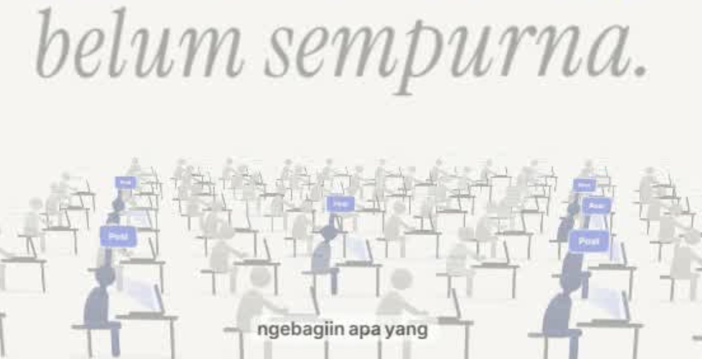
- **Dari:** Builder Trap (11 Nov), adegan ilustrasi orang bekerja di latar terang.
- **Yang salah menurut Irfan:** huruf serif italic tipis berwarna abu pucat dibuat sangat besar sampai menyentuh tepi frame; komposisinya tidak cocok dengan frame dan tidak berhubungan dengan ilustrasi di bawahnya.
- **Juga terlihat:** kotak subtitle di pita bawah ("ngebagiin apa yang") yang mengucapkan hal lain dari judul besar: dua lapisan teks.
- **Bukan pelajarannya:** "serif dilarang". Serif di gaya Arthur Brooks terasa elegan bagi Irfan. Masalahnya kontras, skala, dan hubungan dengan frame.
- **Lantai terkait:** A1, A3, A7.

## 02–07 · Builder Trap v1–v12: datar, ramai, subjek kecil, teks dua lapis
Enam lembar still dari versi-versi Builder Trap (11 Nov) yang ditolak Irfan.

| Gambar | Isi |
|---|---|
| 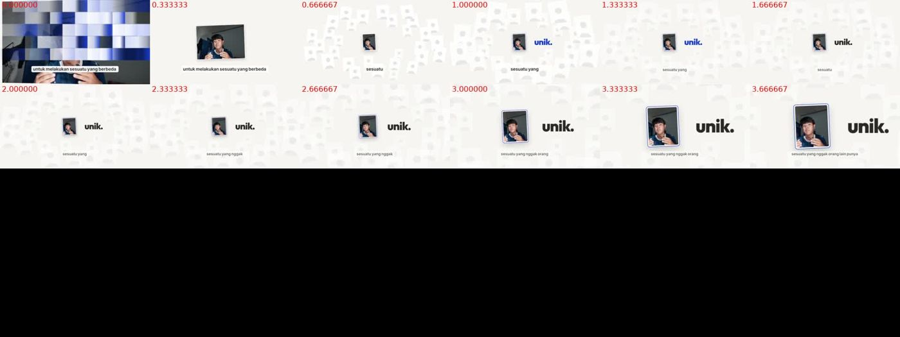 | "unik." + foto wajah kecil di tengah frame kosong, subtitle tumbuh di bawah |
| 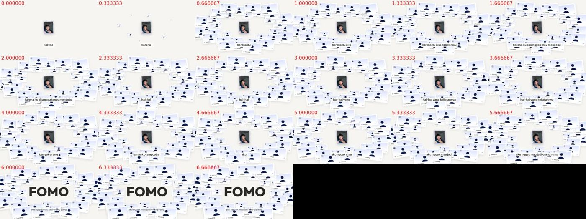 | puluhan kartu "Trending" identik mengelilingi foto kecil; "FOMO" dan subtitle menabrak kartu |
| 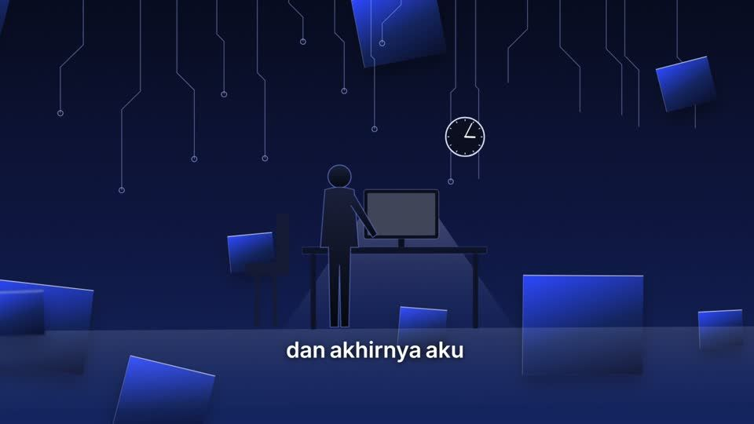 | sosok di meja, garis sirkuit dan kotak biru melayang di navy; subtitle di bawah |
| 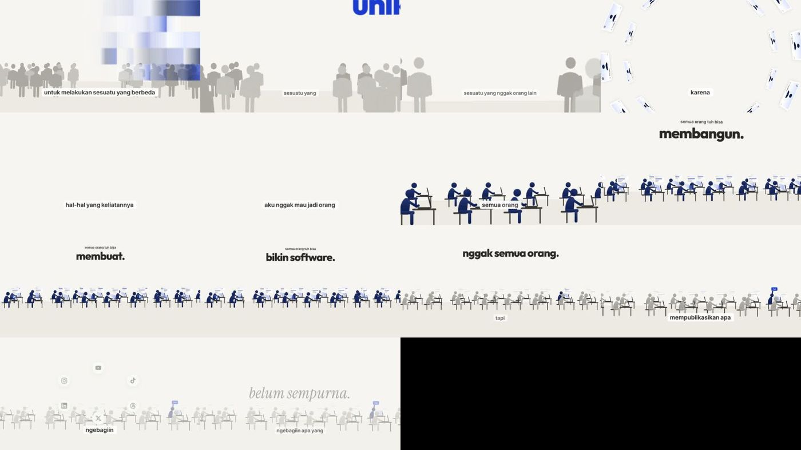 | barisan orang kecil di pita bawah, ±60 % atas kosong; kata kunci kecil mengambang; "Unik" terpotong tepi |
| 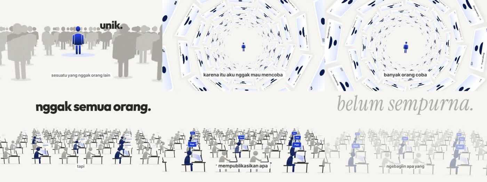 | sosok biru di kerumunan abu, terowongan kartu, barisan meja; subtitle di bawah di semua frame |
| 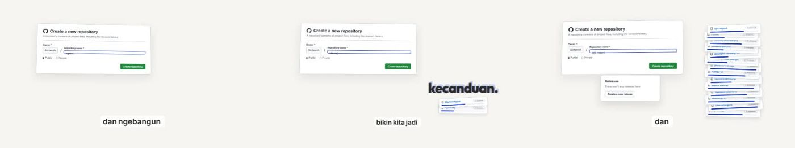 | tampilan GitHub asli tetapi kecil di frame; "kecanduan." menimpa kartu repo |

- **Kata Irfan (11 Nov):** komposisinya kurang; dilihat sebagai satu layer, flat dan ramai sekali; hanya beberapa bagian yang benar-benar bagus; penggunaan font dan kinetic typography masih kurang.
- **Bacaan Claude, sudah disampaikan ke Irfan dan belum ia koreksi:**
  1. Dua lapisan teks: subtitle tetap di pita bawah yang tumbuh kata demi kata + kata besar terpisah (Lantai A1, A3).
  2. Kata kunci terlalu kecil: "unik." ±3–4 % tinggi frame; di kartu 14 kata hero 11–16 % dan 5–7× kata sambungnya.
  3. Kata kunci terpisah jauh dari kalimatnya, bukan satu tumpukan; teks tidak menempel pada subjek (Lantai A2, C15).
  4. Datar: semua elemen satu bidang, sama tajam, sama ukuran, tanpa tekstur; tidak ada lapisan depan dan belakang.
  5. Ramai karena pengulangan objek kecil identik; subjek utama di bawah 10 % frame; ruang kosong tidak disengaja (Lantai C14, C17).
  6. Kotak biru dan garis sirkuit tidak menggambarkan ucapan; biru di navy tenggelam (Lantai D19).
  7. Satu cara tampil teks dari awal sampai akhir.
- **Dugaan frame yang baik (belum dikonfirmasi Irfan):** sosok biru di antara kerumunan abu dengan orang buram di depan; terowongan kartu dengan sosok di tengah. Keduanya punya satu fokus, satu aksen, dan kedalaman.
- **Bukan pelajarannya:** "ilustrasi orang dilarang" atau "latar putih salah". Masalahnya skala, kedalaman, dan teks yang tidak menyatu.

## 08 · BDF26 P1: kontras lokal dan berat frame

[Kasus dan bukti lokal](08-bdf26-p1-kontras-balance.md): dark text di pilar gelap, lalu koreksi semua teks ke kanan yang membuat frame berat kanan. Aturan bersyarat: bedah seluruh frame dan geraknya; warna/posisi/outline dipilih dari gambar aktual. Media/testimoni tidak disalin ke repo.

## 09–11 · Skill-dev journey putaran 4: frame yang lulus juri tetapi ditolak saat dilihat
Tiga frame dari video talking head + kinetic typography (kiblat kartu 83). Ketiganya lulus `qc/JURI.md` dan audit frame, karena yang diperiksa adalah daftar catatan dan cacat teknis, bukan gambarnya.

| Gambar | Yang salah | Yang seharusnya |
|---|---|---|
| 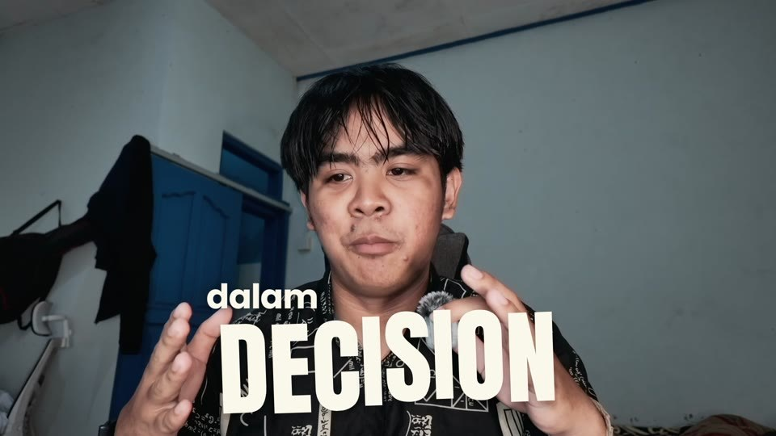 | Kata hero "DECISION" duduk terlalu bawah: tepi bawahnya dekat batas frame, rawan tidak terlihat penonton, dan menutup kedua tangan yang sedang bergestur. Maskot di sekitarnya **tidak** mengganggu. | Naikkan sedikit ke ruang dada/samping kepala; tangan dan batas bawah tetap bebas. |
| 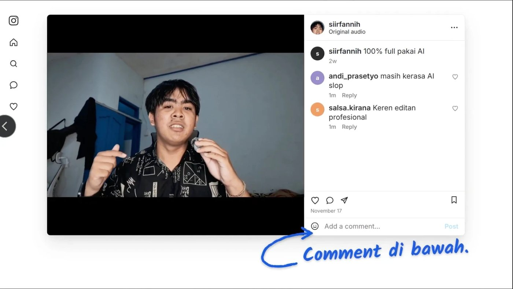 | Tulisan tangan + panah biru jenuh "Comment di bawah." ditempel di luar kartu Instagram yang netral. Warnanya menabrak tampilan dan merusak estetika frame; tulisan tangan tidak cocok dipasang di sini. | Dihapus. Ajakan komentar cukup dibawa tampilan Instagram itu sendiri. |
| 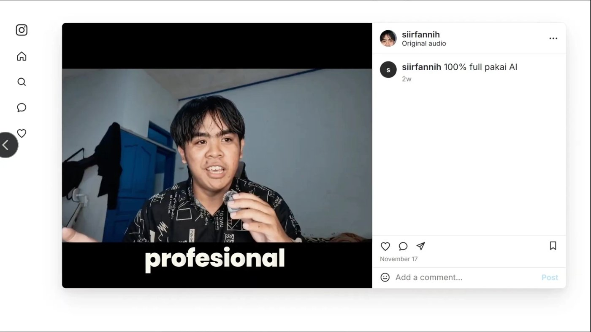 | Kata "profesional" ditaruh di pita hitam di bawah video, padahal di dalam gambar ada ruang kosong di dekat mik. Ceritanya video ini sudah diposting di Instagram, jadi teksnya bagian dari video dan harus berada di dalam bingkainya; di pita bawah ia terbaca sebagai subtitle (Lantai A1). | Teks masuk ke dalam bidang video, di ruang kosong dekat subjek. |

- **Tampilan Instagram-nya sendiri terlalu polos.** Pustaka sudah punya kartu yang membangun tampilan Instagram (kartu 65/08: UI dibangun ulang, satu objek UI dominan, kalimat inline dengan objek UI, 2–3 lapis kedalaman, kamera masuk ke UI; kartu 05: post IG sebagai panggung kalimat). Adegan ini dibangun tanpa membuka kartu-kartu itu.
- **Bukan pelajarannya:** "tulisan tangan dilarang", "panah dilarang", atau "kata hero tidak boleh di dada". Masalahnya warna yang menabrak tampilan netral, teks di luar bidang gambar saat ada ruang di dalamnya, dan posisi yang terlalu dekat batas bawah.
- **Lantai terkait:** A1, A2, C15, C16, C17.

## 12 · Skill-dev journey: atribut teks pindahan tanpa alasan

| Frame | Kenapa jelek | Yang benar |
|---|---|---|
| 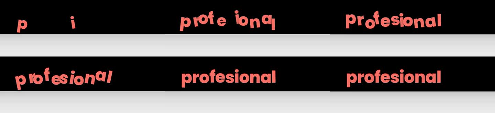 | Kata "profesional" merah coral, ukuran khusus, gaya "kacau", di pita hitam bawah video. Perlakuan ini milik kalimat keraguan lain yang dipindah utuh saat naskah berubah: warna peran "negatif" dipakai untuk kata positif, gaya frustrasi untuk pertanyaan menggoda, ukurannya satu-satunya di luar skala, dan letaknya posisi subtitle. Merahnya juga menabrak tampilan Instagram yang netral. Hurufnya pun baru lengkap ±18 f setelah onset. | Tiap atribut diputus ulang dari makna kata dan adegannya: peran teks yang sudah ada di video (ukuran dan warna dari token), di dalam bidang gambar dekat subjek, emosi lewat satu gerak. |

- **Bukan pelajarannya:** "coral dilarang" atau "efek per huruf dilarang". Masalahnya atribut yang tidak punya alasan di adegan ini.
- **Lantai terkait:** A1, A6, A7; sistem desain (`templates/sistem-desain/README.md`: satu peran teks = satu ukuran).

## 13–17 · Skill-dev journey r7: teknik kartu dipakai tanpa syaratnya
Lima frame dari `varian-A_r7` (talking head + adegan UI dan 3D, kiblat kartu 83 dengan pinjaman 85 dan 87). Kartu diringkas menjadi satu baris angka di brief pekerja; teknik dipakai, tetapi kondisi yang membuatnya bekerja di video asli tidak ikut terbawa.

| Gambar | Yang salah | Kondisi yang membuatnya gagal | Yang seharusnya |
|---|---|---|---|
| 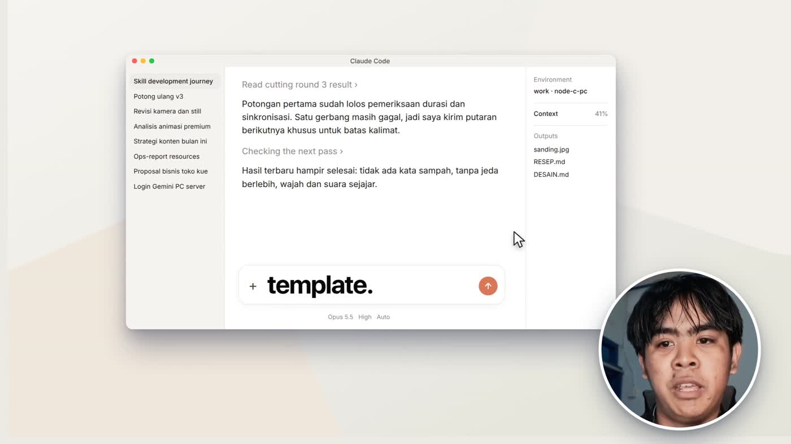 | Kata narasi "template." diketik di kolom prompt Claude Code. | Isi kolom prompt terbaca sebagai perintah yang diketik pengguna, bukan ucapan. | Narasi sebagai teks layar di luar isi UI; kolom prompt hanya berisi yang memang diketik. |
| 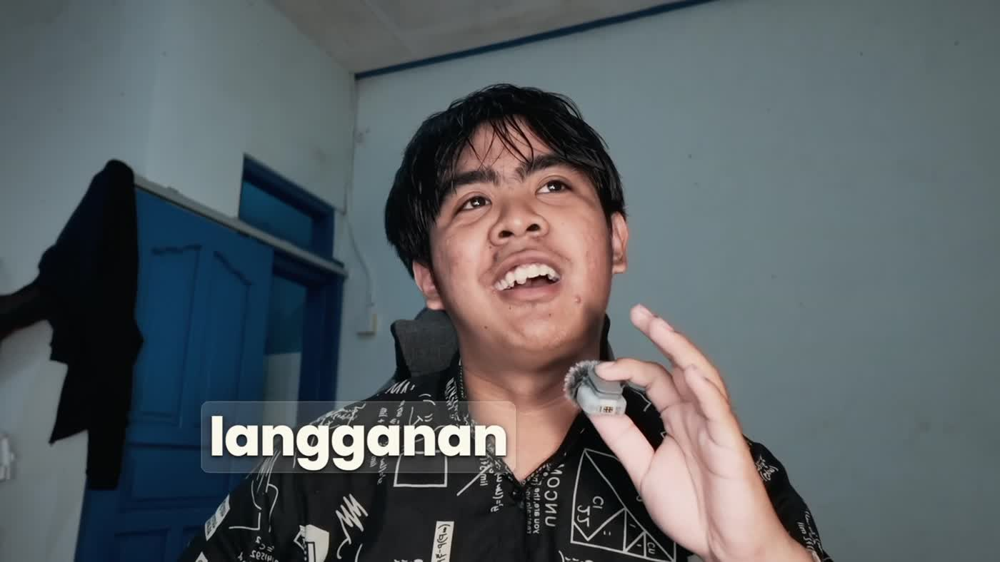 | "langganan" putih di atas kemeja bermotif, pil kaca hampir tidak terlihat di dinding abu-biru terang. | Teknik kata di dada (kartu 83 T4) butuh pakaian polos; kaca butuh latar gelap atau foto berwarna di belakangnya (kartu 63 T4). Keduanya tidak ada di footage ini. | Lembar kondisi footage dibaca dulu: pakaian bermotif → kata di samping kepala; latar terang → teks gelap atau bidang padat, bukan kaca. |
| 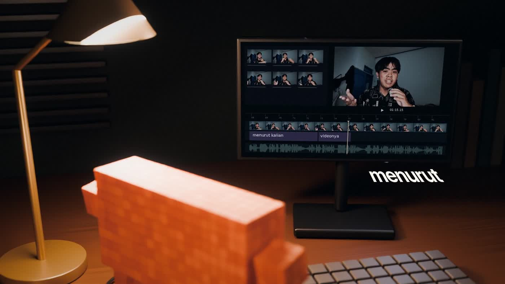 | "menurut" melayang di udara di samping kaki monitor di adegan 3D, sementara monitor menampilkan caption timeline "menurut kalian": kata yang sama dua kali. | Teks tanpa bidang di adegan 3D tidak punya kedalaman yang terbaca; caption di monitor menggandakan teks layar. | Teks menempel di bidang nyata adegan (dinding, layar) atau datar di lapis terdepan (kartu 87 T1); satu kata tampil satu kali. |
| 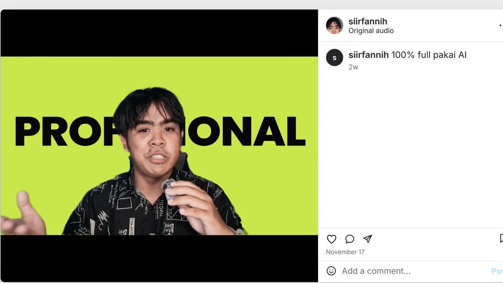 | Punchline "PROFESIONAL" tampil di kotak video hijau kecil di dalam postingan IG. | Slab warna kartu 85 bekerja karena memenuhi layar dan memotong ke luar footage; di kotak kecil skala punchline hilang. Syarat ini tidak ikut di ringkasan satu baris. | Punchline keluar ke layar penuh (kartu 85 T1), lalu kembali ke tampilan IG. |
| 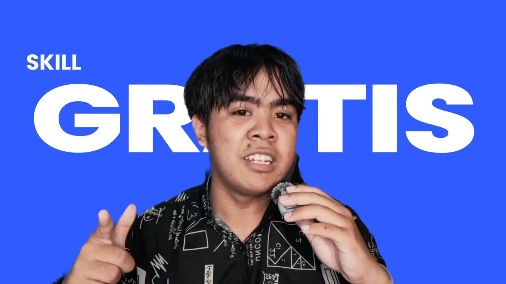 | "SKILL" kecil di kiri atas, jauh dari "GRATIS" besar di slab biru. | Kata pengantar kecil di kartu asli menempel di sudut kata hero (kartu 83 T3b); di sini jaraknya membuat dua pesan. | Kata pengantar menempel di tepi kata hero, atau keduanya satu baris. |

- **Bukan pelajarannya:** "kaca dilarang", "teks di adegan 3D dilarang", "slab biru dilarang", atau "jangan pakai UI". Tekniknya sah; yang gagal adalah memakainya tanpa memeriksa apakah kondisi footage sama dengan kondisi di video asli.
- **Lantai terkait:** A1, A2, A7; `guide/teks/GUIDE.md` §Teks di dalam tampilan aplikasi dan adegan 3D.

## 18 · Teks narasi tipis di atas batu arsip

| Gambar | Yang salah | Kondisi yang membuatnya gagal | Yang seharusnya |
|---|---|---|---|
| 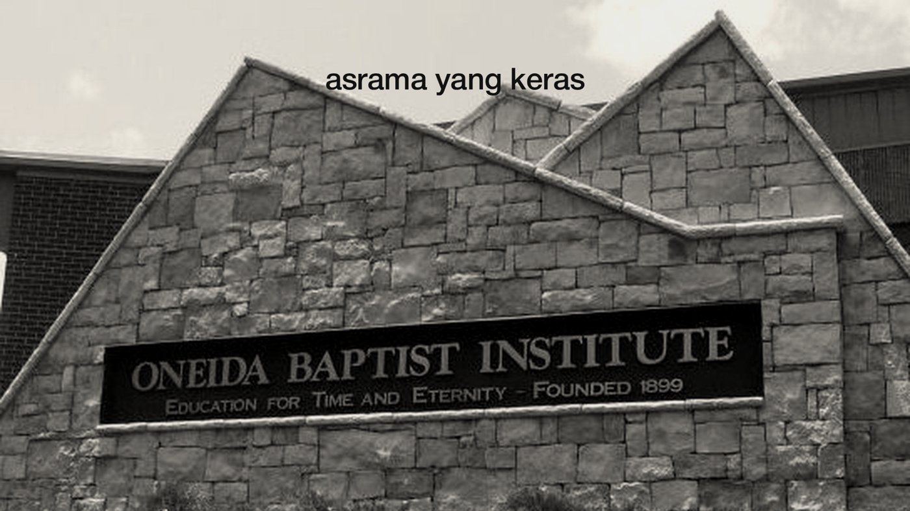 | "asrama yang keras" tinta tipis (Medium ±64 px @1080) mengambang di atas gable batu dan langit pucat foto arsip B&W. | Foto bertekstur abu-abu terang: huruf tipis gelap menabrak tekstur batu, kontras di bawah huruf gagal walau rata-rata latar terang; ukurannya tidak berhubungan dengan papan yang jadi subjek. Bentuknya dikarang, tidak diambil dari kartu. | Ambil bentuk dari kartu yang trigger-nya cocok ("narasi asal-usul di atas foto arsip"): kotak sorot pas-badan (kartu 48 T1) di dekat papan, atau caption grotesk tebal yang ditumpuk di ruang kosong samping subjek (kartu 92 T1). |

- **Bukan pelajarannya:** "teks gelap di foto dilarang" atau "kotak selalu dipakai". Kotak hanya karena teks polos gagal kontras di tekstur itu (Lantai A9).
- **Lantai terkait:** A2, A7, A9; `guide/teks/GUIDE.md` §Posisi (kontras di bawah huruf aktual).
