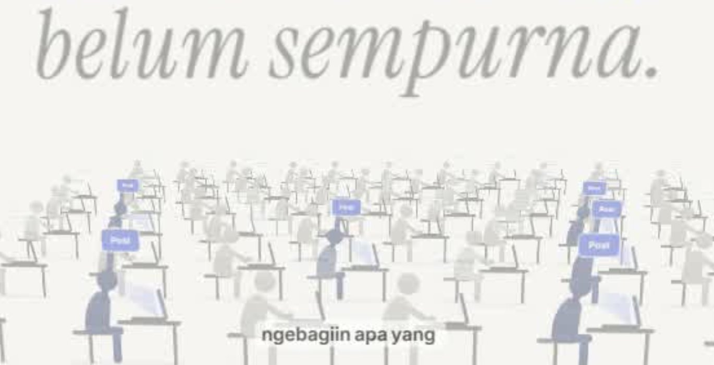
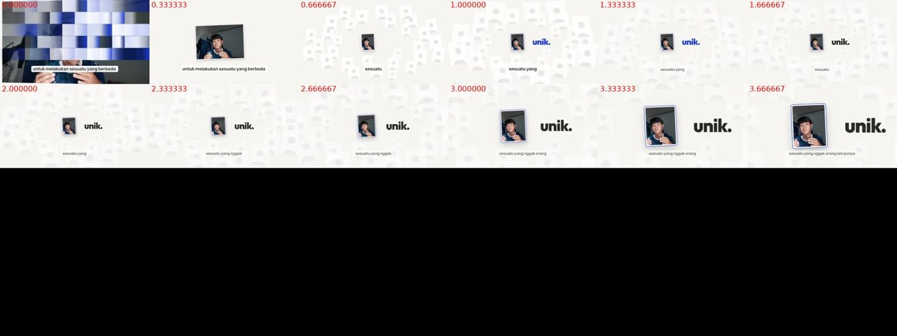
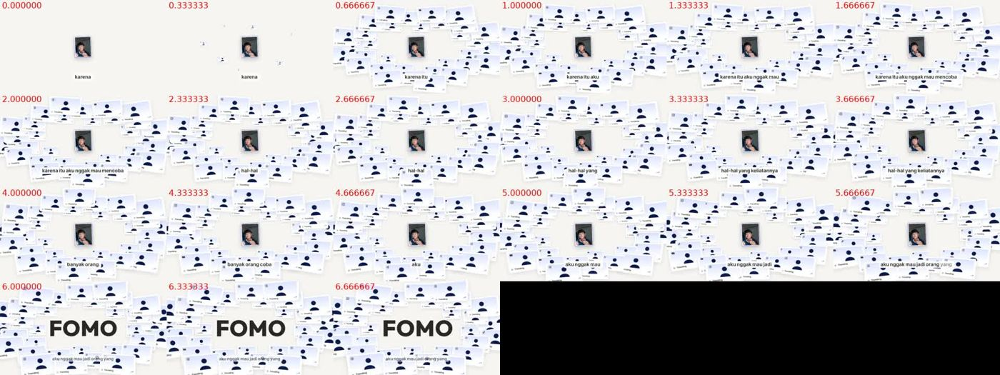
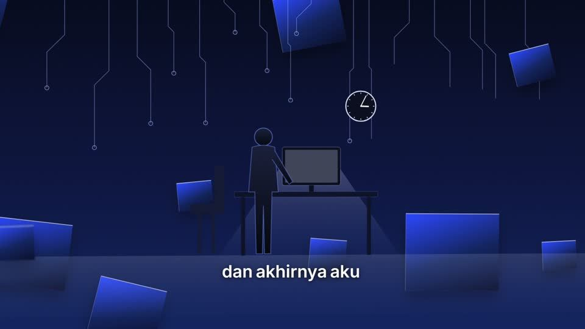
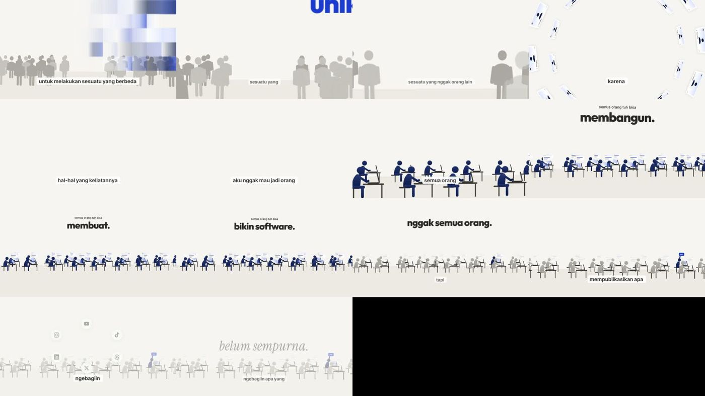
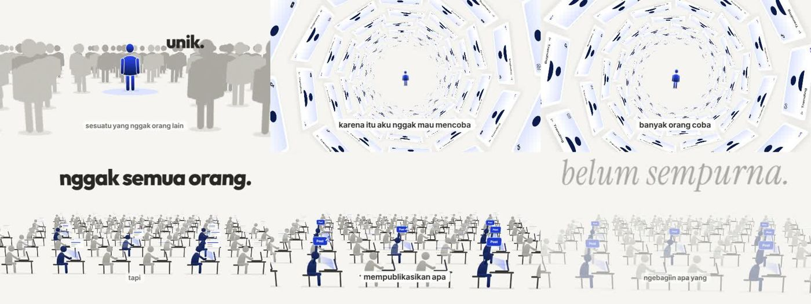
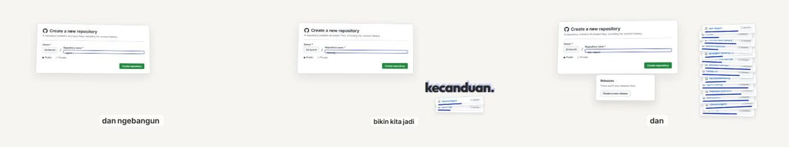

# Contoh gagal

Frame yang pernah Irfan tolak. Tiap entri: gambar, apa yang salah, dan konteksnya. Ini **bukan** daftar larangan: yang ditolak adalah kasusnya, bukan jenis elemennya. Lihat sebelum menilai still sendiri.

Menambah entri: simpan frame sebagai `<no>-<nama-pendek>.jpg` (lebar ≤ 1400 px), tambah satu blok di bawah.

## 01 · Serif pucat raksasa + subtitle kotak

- **Dari:** Builder Trap (11 Nov), adegan ilustrasi orang bekerja di latar terang.
- **Yang salah menurut Irfan:** huruf serif italic tipis berwarna abu pucat dibuat sangat besar sampai menyentuh tepi frame; komposisinya tidak cocok dengan frame dan tidak berhubungan dengan ilustrasi di bawahnya.
- **Juga terlihat:** kotak subtitle di pita bawah ("ngebagiin apa yang") yang mengucapkan hal lain dari judul besar: dua lapisan teks.
- **Bukan pelajarannya:** "serif dilarang". Serif di gaya Arthur Brooks terasa elegan bagi Irfan. Masalahnya kontras, skala, dan hubungan dengan frame.
- **Lantai terkait:** A1, A3, A7.

## 02–07 · Builder Trap v1–v12: datar, ramai, subjek kecil, teks dua lapis
Enam lembar still dari versi-versi Builder Trap (11 Nov) yang ditolak Irfan.

| Gambar | Isi |
|---|---|
|  | "unik." + foto wajah kecil di tengah frame kosong, subtitle tumbuh di bawah |
|  | puluhan kartu "Trending" identik mengelilingi foto kecil; "FOMO" dan subtitle menabrak kartu |
|  | sosok di meja, garis sirkuit dan kotak biru melayang di navy; subtitle di bawah |
|  | barisan orang kecil di pita bawah, ±60 % atas kosong; kata kunci kecil mengambang; "Unik" terpotong tepi |
|  | sosok biru di kerumunan abu, terowongan kartu, barisan meja; subtitle di bawah di semua frame |
|  | tampilan GitHub asli tetapi kecil di frame; "kecanduan." menimpa kartu repo |

- **Kata Irfan (11 Nov):** komposisinya kurang; dilihat sebagai satu layer, flat dan ramai sekali; hanya beberapa bagian yang benar-benar bagus; penggunaan font dan kinetic typography masih kurang.
- **Bacaan Claude, sudah disampaikan ke Irfan dan belum ia koreksi:**
  1. Dua lapisan teks: subtitle tetap di pita bawah yang tumbuh kata demi kata + kata besar terpisah (Lantai A1, A3).
  2. Kata kunci terlalu kecil: "unik." ±3–4 % tinggi frame; di kartu 14 kata hero 11–16 % dan 5–7× kata sambungnya.
  3. Kata kunci terpisah jauh dari kalimatnya, bukan satu tumpukan; teks tidak menempel pada subjek (Lantai A2, C15).
  4. Datar: semua elemen satu bidang, sama tajam, sama ukuran, tanpa tekstur; tidak ada lapisan depan dan belakang.
  5. Ramai karena pengulangan objek kecil identik; subjek utama di bawah 10 % frame; ruang kosong tidak disengaja (Lantai C14, C17).
  6. Kotak biru dan garis sirkuit tidak menggambarkan ucapan; biru di navy tenggelam (Lantai D19).
  7. Satu cara tampil teks dari awal sampai akhir.
- **Dugaan frame yang baik (belum dikonfirmasi Irfan):** sosok biru di antara kerumunan abu dengan orang buram di depan; terowongan kartu dengan sosok di tengah. Keduanya punya satu fokus, satu aksen, dan kedalaman.
- **Bukan pelajarannya:** "ilustrasi orang dilarang" atau "latar putih salah". Masalahnya skala, kedalaman, dan teks yang tidak menyatu.
